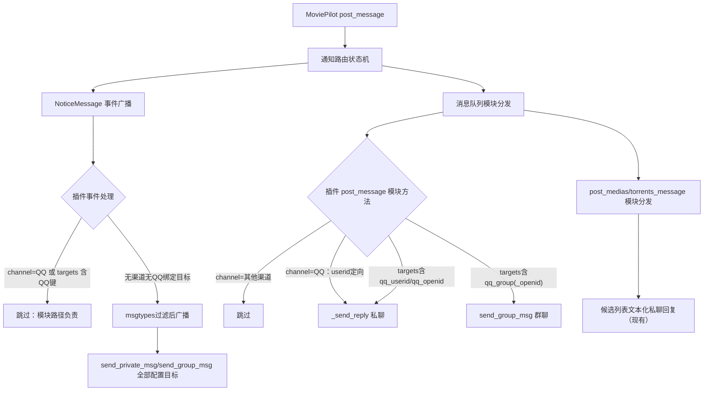

# NapCat 完整接管 MoviePilot V3 消息通道

Feature Name: napcat-full-takeover
Updated: 2026-10-10

## Description

让 NapCatMsg 插件成为 MoviePilot V3 中 QQ 渠道的完整实现：

- 插件声明 `post_message` 模块方法，接管 channel=QQ 定向消息（交互回复）与用户绑定 QQ 目标的按用户路由通知
- 事件广播路径（`NoticeMessage`）收敛为只处理无渠道、无 QQ 绑定目标的广播通知，消除双通道重复发送
- 目标键与官方 QQ 机器人模块（`app/modules/qqbot/module.py`）对齐：qq_userid / qq_openid / qq_group_openid / qq_group

## Architecture



宿主侧分发事实（源码依据）：

- `app/chain/_messaging.py` `_dispatch_notification_steps`：每条通知先 `eventmanager.send_event(EventType.NoticeMessage, ...)` 广播，再经 `messagequeue.send_message("post_message", ...)` 模块分发
- 模块分发调用所有实现了该方法的模块（内置 + 插件 `get_module()`），各模块自行按渠道/目标过滤
- `post_medias_message` / `post_torrents_message` 仅走模块分发，广播事件（现有插件已实现）
- 事件数据 = `{**message.model_dump(exclude={"save_history"}), "type": message.mtype}`，含 `targets` 字典；`notification_route_scope` 为私有属性，事件数据不含

## Components and Interfaces

### 1. `get_module()` 扩展（plugins.v3/napcatmsg/__init__.py）

```python
def get_module(self):
    return {
        "post_message": self._module_post_message,
        "post_medias_message": self._module_post_medias_message,
        "post_torrents_message": self._module_post_torrents_message,
    }
```

### 2. `_module_post_message(message: Message) -> None`

自过滤规则（与官方 qqbot 模块 `check_message` 语义对齐）：

1. `message.channel` 存在且非 `NotificationChannel.QQ` → 跳过
2. `message.channel == QQ`：取 `message.userid` 定向私聊（交互回复路径）；无 userid 时跳过
3. `channel` 为空：解析 `message.targets` 中的 QQ 目标键，命中则定向发送（私聊 + 群聊）；未命中 → 跳过（事件路径广播兜底）

QQ 目标键解析（模块级常量）：

```python
_QQ_USER_TARGET_KEYS = ("qq_userid", "qq_openid")
_QQ_GROUP_TARGET_KEYS = ("qq_group_openid", "qq_group")
```

### 3. `send()`（NoticeMessage 事件处理）收敛

新增跳过分支：

- `channel == QQ` → 跳过（模块路径 `_module_post_message` 负责）
- `channel` 为空且 `targets` 含任一 QQ 目标键 → 跳过（模块路径负责定向发送）
- 其余行为保持：msgtypes 过滤 + 全量目标广播

### 4. 目标解析与发送复用

- 新增 `_targets_from_message(message) -> List[Tuple[str, dict, str]]`：从 Message 对象解析 (action, extra, desc) 发送目标
- `_post_onebot` 复用（现有），消息段组装复用现有 `_send`/`_send_reply` 逻辑，抽取公共 `_build_segments(title, text, image, at_all)`
- `userid` 兼容 str/int（`Message.userid: Optional[Union[str, int]]`），解析失败记录日志跳过

## Data Models

- 输入：宿主 `Message` 对象（模块路径）/ 事件 dict（事件路径，含 `targets`）
- QQ 目标键：`qq_userid`、`qq_openid` → 私聊；`qq_group_openid`、`qq_group` → 群聊（与 `app/modules/qqbot/module.py:38-43` 一致）
- NapCat OneBot 11 请求：`send_private_msg {user_id}` / `send_group_msg {group_id}`，消息段数组

## Correctness Properties

1. **无重复**：任一条通知经插件至多发送一次（事件路径与模块路径互斥分区）
2. **完备性**：channel=QQ 定向消息与 QQ 绑定目标消息由模块路径送达；无渠道广播消息由事件路径送达
3. **隔离性**：其他渠道消息（Telegram/微信等）经插件零发送
4. **兼容性**：插件全局配置目标（send_users/send_groups）在广播路径行为与 v1.1.5 一致；双向交互回复链路不变

## Error Handling

- `userid`/目标键值非法（非数字）→ 记录 warning 日志，跳过该目标，其余目标继续
- NapCat HTTP 失败 → 沿用 `_post_onebot` 现有错误聚合与日志
- 模块方法内部异常由宿主 `run_module` 错误处理器兜底（记录 + SystemError 事件），插件内不抛出

## Test Strategy

扩展 `tests/v3/napcatmsg/test_plugin.py`：

1. 模块路径：channel=QQ 消息 → `send_private_msg` 定向；channel=Telegram → 零请求；channel=None + targets(qq_userid/qq_group) → 定向私聊/群聊；targets 无 QQ 键 → 零请求
2. 事件路径：channel=QQ 事件 → 零请求（去重）；targets 含 qq_userid 事件 → 零请求；无渠道事件 → 按配置广播（回归）
3. 目标键非法值 → 跳过并继续其余目标
4. 双向交互回归：report 端点、候选列表拦截保持原有断言
5. 回归命令：`python3 tests/v3/napcatmsg/test_plugin.py`；V2 smoke test 保持通过

## References

[^1]: MoviePilot v3 `app/chain/_messaging.py` `_dispatch_notification_steps`（L387-428）
[^2]: MoviePilot v3 `app/modules/qqbot/module.py` QQ 目标键定义（L38-44）
[^3]: MoviePilot v3 `app/modules/__init__.py` `check_message` 渠道过滤语义（L261-294）
[^4]: MoviePilot v3 `app/runtime/extensions/plugin/projection.py` 插件模块聚合（L88-108）
[^5]: 当前工作区 `plugins.v3/napcatmsg/__init__.py`
